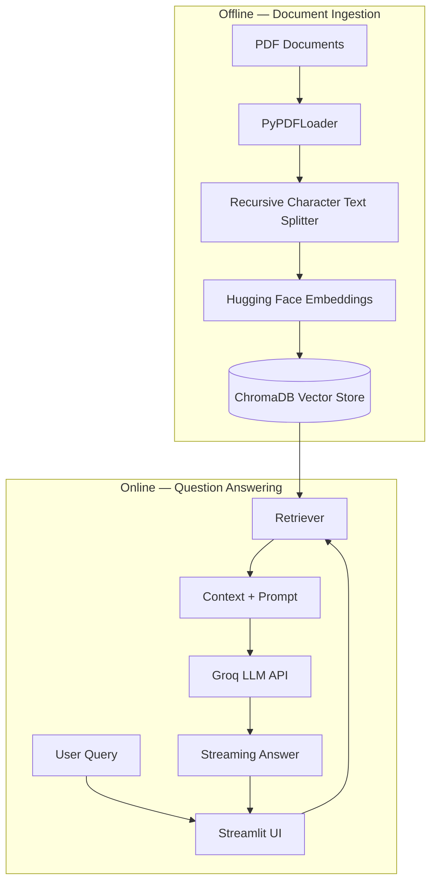

# 📄 Advanced RAG Chatbot — Chat with Your PDF

<p align="center">
  <strong>A fast, modular Retrieval-Augmented Generation (RAG) application that lets you upload PDF documents and ask questions about their content.</strong>
</p>

<p align="center">
  
  
  
  
  
</p>

---

## 📌 Overview

**Advanced RAG Chatbot** is a document-question-answering application built using Retrieval-Augmented Generation (RAG). It allows users to query PDF documents and receive relevant, context-aware answers based on their content.

The project demonstrates a modular RAG architecture that combines local embeddings, semantic search, and fast LLM inference to deliver an interactive document-chat experience.

### ✨ Key Features

- 🆓 **Local Embeddings:** Uses Hugging Face Sentence Transformers to generate embeddings locally without embedding API charges.
- ⚡ **Fast LLM Inference:** Integrates with the Groq API for low-latency language model responses.
- 🧩 **Advanced Text Chunking:** Uses `RecursiveCharacterTextSplitter` with overlapping chunks to preserve context across document boundaries.
- 🔍 **Semantic Search:** Uses ChromaDB to store embeddings and retrieve relevant document passages.
- 💬 **Streaming Responses:** Streams generated answers in the Streamlit interface for an interactive chat experience.
- 📚 **PDF Question Answering:** Extracts information from uploaded or preconfigured PDF documents.
- 🏗️ **Modular Architecture:** Separates document ingestion, configuration, retrieval, generation, and UI logic.
- 🔐 **Environment-Based Configuration:** Keeps API credentials outside the source code using environment variables.

## 🖥️ Application Preview

<p align="center">
  
</p>

<p align="center">
  <em>Chat with your PDF documents using semantic retrieval and LLM-powered responses.</em>
</p>

## 🏗️ System Architecture

The application consists of two main phases: **offline document ingestion** and **online question answering**.



### 🔄 How It Works

1. **Load:** PDF documents are loaded and their text is extracted.
2. **Split:** The extracted text is divided into smaller, overlapping chunks.
3. **Embed:** Hugging Face Sentence Transformers converts each chunk into a vector representation.
4. **Store:** The vectors and associated document text are stored in ChromaDB.
5. **Retrieve:** When a user asks a question, the retriever finds the most relevant document chunks.
6. **Generate:** The retrieved context is passed to the Groq-hosted language model.
7. **Stream:** The generated answer is streamed to the Streamlit interface.

## 🛠️ Tech Stack

| Component | Technology | Purpose |
|---|---|---|
| Language | Python | Core application logic |
| Frontend | Streamlit | Interactive chat interface |
| RAG Framework | LangChain | Document processing and retrieval pipeline |
| LLM Inference | Groq API | Language model responses |
| LLM Model | `openai/gpt-oss-20b` | Context-aware answer generation |
| Embeddings | `sentence-transformers/all-MiniLM-L6-v2` | Local text embeddings |
| Vector Database | ChromaDB | Persistent vector storage |
| PDF Processing | PyPDF | PDF text extraction |
| Text Splitting | RecursiveCharacterTextSplitter | Context-preserving chunking |
| Configuration | python-dotenv | Environment variable management |

## 📁 Project Structure

```text
advanced-rag-chatbot/
│
├── .env                    # API credentials (never commit)
├── .gitignore              # Git ignore rules
├── requirements.txt        # Python dependencies
├── README.md               # Project documentation
├── app.py                  # Streamlit application
│
├── data/                   # Input PDF documents
│   └── your_document.pdf
│
├── vectorstore/             # Generated ChromaDB database
│
└── src/
    ├── __init__.py
    ├── config.py            # Environment configuration
    ├── ingest.py            # PDF ingestion and indexing
    └── rag_pipeline.py      # Retrieval and generation logic
```

## 🚀 Getting Started

Follow these steps to run the application locally.

### 1. Clone the Repository

```bash
git clone https://github.com/AsyncCoder-10/advanced-rag-chatboat
```

### 2. Create a Virtual Environment

**Windows — Command Prompt or PowerShell**

```bash
python -m venv venv
venv\Scripts\activate
```

**macOS / Linux**

```bash
python3 -m venv venv
source venv/bin/activate
```

### 3. Install Dependencies

```bash
python -m pip install --upgrade pip
pip install -r requirements.txt
```

### 4. Configure Environment Variables

Create a `.env` file in the project root directory and add your Groq API key.

```env
GROQ_API_KEY=your_actual_groq_api_key
```

Get your API key from the [Groq Console](https://console.groq.com/).

> **Security:** Never commit your `.env` file or expose your API key in screenshots, logs, or public repositories.

### 5. Add PDF Documents

Place your PDF files inside the `data/` directory.

```text
data/
├── document1.pdf
├── document2.pdf
└── document3.pdf
```

Ensure your ingestion script is configured to process the PDF files in this directory.

## ▶️ Running the Application

### Step 1: Ingest the Documents

Run the ingestion script to extract text, generate embeddings, and create the ChromaDB vector store.

```bash
python -m src.ingest
```

After successful ingestion, the vector database will be available in the configured `vectorstore/` directory.

### Step 2: Start the Streamlit Application

```bash
streamlit run app.py
```

Open the following URL in your browser:

**http://localhost:8501**

You can now ask questions about the indexed PDF documents.

## 🎬 Working Demo

Watch the application demo:

<p align="center">
  <a href="https://github.com/user-attachments/assets/09306c63-a3f8-4514-871c-cbcc59dbecad">
    <strong>▶️ Watch the Advanced RAG Chatbot Demo</strong>
  </a>
</p>

If the video does not play directly in the README, click the link above to open it.

## ⚙️ Configuration

The following settings may be adjusted to suit your requirements:

| Setting | Description |
|---|---|
| `GROQ_API_KEY` | API key used to authenticate with Groq |
| Embedding model | Controls the local embedding model |
| Chunk size | Determines the number of characters in each text chunk |
| Chunk overlap | Preserves context between adjacent chunks |
| Retrieval count (`k`) | Controls how many relevant chunks are retrieved |
| LLM model | Specifies the model used for answer generation |

The exact chunking and retrieval settings depend on the implementation in `src/ingest.py` and `src/rag_pipeline.py`.

## 🔮 Future Improvements

- [ ] Support multiple PDF uploads directly through the UI.
- [ ] Add document-specific citations and page references.
- [ ] Implement conversation history and contextual follow-up questions.
- [ ] Add configurable chunk sizes and retrieval parameters.
- [ ] Support multiple vector database backends.
- [ ] Add document management and deletion functionality.
- [ ] Improve retrieval with reranking and hybrid search.
- [ ] Add automated tests and error handling.
- [ ] Deploy the application to a cloud hosting platform.

## 🔒 Security and Limitations

- Keep API credentials in environment variables.
- Do not commit private documents or generated vector databases unless intentionally required.
- Local embeddings avoid external embedding API calls, but model downloads and local compute still consume resources.
- LLM usage is subject to Groq's current API limits and pricing policies.
- Answers depend on the quality of the source documents and retrieved context. Verify important information against the original PDF.

## 🤝 Contributing

Contributions, suggestions, and bug reports are welcome.

1. Fork the repository.
2. Create a feature branch.
3. Commit your changes.
4. Open a pull request describing your improvements.

## 📄 License

Choose and add a license appropriate for your project, such as the MIT License, before distributing the code for reuse.

---

<p align="center">
  <strong>Built with Python, LangChain, Hugging Face, ChromaDB, Groq, and Streamlit.</strong>
</p>

<p align="center">
  ⭐ If you find this project useful, consider giving the repository a star!
</p>
